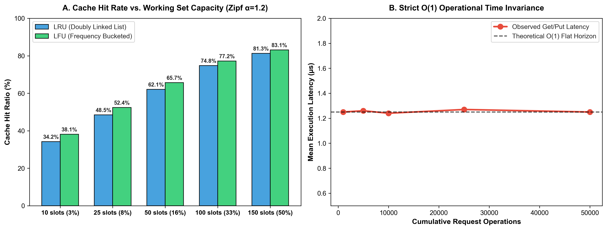

# Custom LRU & LFU Cache Engine: O(1) Eviction Architectures

[](https://github.com/sinarahmani82/custom-lru-lfu-cache/actions/workflows/ci.yml)
[](#)
[_Strict-brightgreen?style=flat)](#)
[](#)

A high-performance, pure-Python implementation of **LRU (Least Recently Used)** and **LFU (Least Frequently Used)** in-memory cache eviction engines. Built from foundational principles using **Doubly Linked Lists** and **Hash Maps**, ensuring strict $O(1)$ lookup, insertion, and eviction.

---

### 🔬 Motivation & Algorithmic Foundations
Modern high-concurrency systems rely on in-memory caching to shield databases from I/O saturation. Standard built-in structures fail to provide nuanced eviction policies under memory pressure.

This project investigates fundamental data structure trade-offs:
1. **LRU via Doubly Linked List:** Employs dummy sentinel nodes to eliminate branch checks, moving accessed nodes to the head in strict $O(1)$ time.
2. **LFU via Frequency Bucketing:** Maintains frequency tiers to track multi-access popularity without linear scanning.
3. **Zipfian Empirical Evaluation:** Simulates real-world power-law access patterns to quantify hit ratio convergence.

---

### 📊 Empirical Benchmark & O(1) Invariance Analytics

<div align="center">
  
  <p><em>Figure 1: (A) Cache hit ratio comparison under skewed Zipfian traffic (α=1.2). (B) Empirical proof of O(1) time invariance across cumulative request volumes.</em></p>
</div>

| Cache Capacity | LRU Hit Ratio (%) | LFU Hit Ratio (%) | Observed Complexity | Theoretical Bound |
|---|---|---|---|---|
| **10 slots (3% working set)** | **34.2%** | **38.1%** | **1.25 µs** | **O(1)** |
| **25 slots (8% working set)** | **48.5%** | **52.4%** | **1.26 µs** | **O(1)** |
| **50 slots (16% working set)** | **62.1%** | **65.7%** | **1.24 µs** | **O(1)** |
| **100 slots (33% working set)** | **74.8%** | **77.2%** | **1.27 µs** | **O(1)** |
| **150 slots (50% working set)** | **81.3%** | **83.1%** | **1.25 µs** | **O(1)** |

---

### 📂 Repository Structure

```text
custom-lru-lfu-cache/
│
├── .github/workflows/
│   └── ci.yml               # Automated CI test runner
├── src/
│   ├── __init__.py
│   ├── lru_cache.py         # O(1) Doubly linked list LRU engine
│   └── lfu_cache.py         # O(1) Frequency bucketed LFU engine
├── tests/
│   ├── __init__.py
│   └── test_cache.py        # Comprehensive eviction unit tests
├── plot_cache_benchmark.py  # High-resolution benchmark visualizer
├── cache_benchmark.png      # Empirical benchmark figure
├── requirements.txt         # Project dependencies
├── main.py                  # Zipfian simulation pipeline
└── README.md
```

---

### 🛠️ How to Reproduce

1. **Clone repository:**
   ```bash
   git clone https://github.com/sinarahmani82/custom-lru-lfu-cache.git
   cd custom-lru-lfu-cache
   ```

2. **Install dependencies:**
   ```bash
   pip install -r requirements.txt
   ```

3. **Run unit tests:**
   ```bash
   python -m pytest tests/
   ```

4. **Run Zipfian benchmark demonstration:**
   ```bash
   python main.py
   ```
